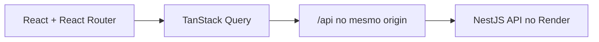

# GameTrack Web

[](https://github.com/LucasCruz2773/game-tracker-web/actions/workflows/ci.yml)

Frontend do **GameTrack**, uma aplicação responsiva para descobrir jogos, organizar uma biblioteca pessoal, acompanhar progresso, publicar reviews e visualizar estatísticas.

- Demonstração: https://game-tracker-web-two.vercel.app
- Backend: [LucasCruz2773/game-tracker-api](https://github.com/LucasCruz2773/game-tracker-api)
- Health da API: https://game-tracker-api-68q1.onrender.com/health

> A API utiliza uma instância gratuita do Render. O primeiro acesso após um período de inatividade pode levar alguns segundos.

## Funcionalidades

- Login seguro com Google.
- Busca de jogadores com opção de seguir e deixar de seguir.
- Conexão da conta Steam e importação em lotes com status e nota por jogo.
- Sincronização manual das horas registradas pela Steam.
- Busca, paginação e visualização de detalhes de jogos.
- Biblioteca filtrável, com edição direta de status e nota de cada jogo.
- Registro de horas jogadas e datas de início e conclusão.
- Criação, edição e exclusão de reviews.
- Notas em meias estrelas, de 0,5 a 5.
- Dashboard com totais, horas jogadas e média de avaliações.
- Estados de carregamento, erro e conteúdo vazio.
- Interface responsiva em português brasileiro.

## Stack

- React 19 e TypeScript
- Vite 8 e React Router 8
- TanStack Query 5 para estado do servidor
- Tailwind CSS 4
- Vitest e Playwright
- Oxlint e Prettier
- Vercel para hospedagem e proxy da API
- Steam OpenID para vínculo seguro da conta

## Arquitetura



Os componentes não acessam o banco ou a RAWG diretamente. Toda informação de servidor passa pela API e é gerenciada pelo TanStack Query. Estado temporário de interface permanece local; não há uma store global sem necessidade concreta.

Em desenvolvimento, o Vite encaminha `/api` para `http://localhost:3000`. Em produção, a Vercel aplica a mesma estratégia e encaminha `/api/*` para o Render, mantendo os cookies no mesmo origin percebido pelo navegador.

## Rotas

| Rota             | Página                            |
| ---------------- | --------------------------------- |
| `/login`         | Login com Google                  |
| `/`              | Busca e jogos populares           |
| `/games/:gameId` | Detalhes, biblioteca e reviews    |
| `/library`       | Biblioteca com filtros por status |
| `/dashboard`     | Estatísticas da biblioteca        |
| `/players`       | Busca e conexão com jogadores     |
| `/integrations`  | Importação e sincronização Steam  |

Rotas privadas usam `RequireAuth`; a sessão é consultada em `GET /api/auth/me`.

## Executando localmente

### Requisitos

- Node.js **24**
- [GameTrack API](https://github.com/LucasCruz2773/game-tracker-api) em execução

### Instalação

```bash
cp .env.example .env
npm install
npm run dev
```

A aplicação ficará disponível em `http://localhost:5173`.

Por padrão, o Vite encaminha `/api` para `http://localhost:3000`. Para usar outra instância:

```bash
API_PROXY_TARGET=http://localhost:3100 npm run dev
```

`API_PROXY_TARGET` é usado somente pelo servidor de desenvolvimento e não contém segredos.

## Organização do código

```text
src/
├── app/             # router e layout
├── components/      # componentes compartilhados
├── features/
│   ├── auth/
│   ├── dashboard/
│   ├── games/
│   ├── integrations/
│   ├── library/
│   ├── reviews/
│   └── social/
├── lib/             # cliente HTTP, datas e query client
├── pages/           # páginas de erro e rota inexistente
└── types/
```

Cada feature reúne seus componentes, hooks, tipos e integração HTTP para reduzir acoplamento entre domínios.

## Qualidade e testes

```bash
npm run format:check
npm run lint
npm run typecheck
npm test
npm run build
```

Para os fluxos completos:

```bash
npm run test:e2e
```

O Playwright inicia automaticamente:

1. Um servidor RAWG falso na porta `3200`.
2. A API em modo de teste na porta `3100`.
3. O Vite na porta `5199`.

Os cenários cobrem autenticação, biblioteca, reviews e dashboard sem depender do OAuth real. A API possui testes próprios para a integração Steam. Ela deve estar em `../game-tracker-api`; outra localização pode ser informada em `GAMETRACK_API_DIR`.

O GitHub Actions executa formatação, lint, typecheck, testes unitários e build em pushes para `main` e pull requests.

## Scripts

| Comando             | Descrição                        |
| ------------------- | -------------------------------- |
| `npm run dev`       | Inicia o Vite                    |
| `npm run build`     | Verifica os tipos e gera `dist/` |
| `npm run preview`   | Serve o build localmente         |
| `npm run typecheck` | Verifica TypeScript              |
| `npm test`          | Executa testes unitários         |
| `npm run test:e2e`  | Executa os fluxos Playwright     |
| `npm run lint`      | Executa o Oxlint                 |

## Deploy

O frontend está hospedado na Vercel. O arquivo [`vercel.json`](./vercel.json):

- encaminha `/api/*` para a API no Render;
- entrega `index.html` para as rotas da SPA.

O frontend não recebe credenciais do banco, Google ou RAWG. Esses segredos existem somente no ambiente da API.

## Roadmap

- Perfil público.
- Listas personalizadas.
- Feed de atividades e notificações sociais.
- Recomendações personalizadas.

Funcionalidades de infraestrutura serão adicionadas somente quando houver uma necessidade concreta.
